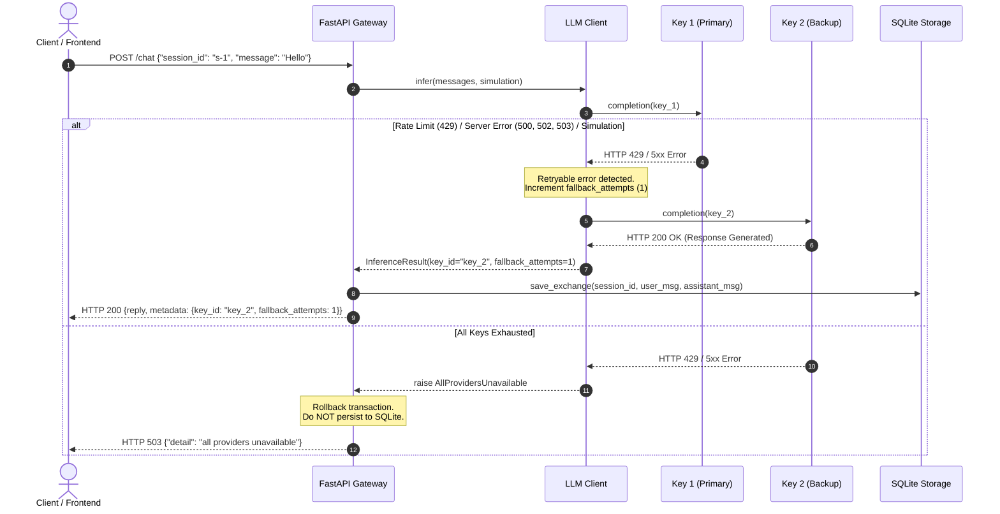
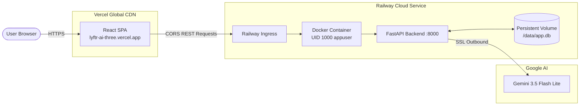

# LYFTR AI — Inference Control Center

> **Full-Stack Assignment**: LLM Chatbot with Key Failover and Response Caching  
> A production-grade multi-turn AI chatbot and inference gateway featuring automatic provider-key failover, session-agnostic response caching, accurate per-request token telemetry, and persistent SQLite session storage.

[](backend/tests/)
[](frontend/src/test/)
[](https://www.python.org/)
[](https://fastapi.tiangolo.com/)
[](https://react.dev/)
[](https://www.sqlite.org/)
[](https://www.docker.com/)

---

## 1. Live Deployment

The full-stack application is deployed publicly and fully testable across both tiers:

| Component | Platform | URL |
| :--- | :--- | :--- |
| **Live Frontend Application** | Vercel (Global Edge CDN) | [https://lyftr-ai-three.vercel.app/](https://lyftr-ai-three.vercel.app/) |
| **Live Backend API Gateway** | Railway (Persistent Docker Container) | [https://lyftr-ai-production-f8d0751a.up.railway.app/](https://lyftr-ai-production-f8d0751a.up.railway.app/) |
| **API Health Check** | Railway | [https://lyftr-ai-production-f8d0751a.up.railway.app/health](https://lyftr-ai-production-f8d0751a.up.railway.app/health) |
| **API Documentation (Swagger)** | Railway | [https://lyftr-ai-production-f8d0751a.up.railway.app/docs](https://lyftr-ai-production-f8d0751a.up.railway.app/docs) |
| **Public GitHub Repository** | GitHub | [https://github.com/PepperBitt/lyftr-ai](https://github.com/PepperBitt/lyftr-ai) |

---

## 2. Features

- **Multi-Turn Conversation & Session Persistence**: Full conversational memory stored in SQLite across multiple sessions. History is retrieved dynamically and contextually injected into LLM prompts.
- **Automatic Provider-Key Failover**: Configurable API key pool (`key_1`, `key_2`, ...). Automatically retries on rate limits (HTTP 429), quota exhaustion (`resource_exhausted`), transient server errors (HTTP 500, 502, 503, 504), connection failures, and timeouts.
- **Exact-Match Response Caching**: In-memory caching via LiteLLM. Resolves identical prompts across sessions in **~5ms** (a 99.6% reduction from ~1300ms live calls) while consuming 0 upstream tokens.
- **Accurate Per-Request Telemetry**: Returns exact token counts (`input_tokens`, `output_tokens`), server latency in milliseconds (`latency_ms`), resolution source (`LIVE_INFERENCE` or `LLM_CACHE`), key identifier (`key_id`), and failover count (`fallback_attempts`) with every response.
- **Interactive Failure Simulation**: Support for `X-Simulate-Failure` header (e.g., `key_1=429`, `key_1=500`, `key_1=502`, `key_1=503`, `key_1=429,key_2=500`, `*=429`) to verify and demonstrate failover on demand without exhausting real provider keys.
- **Graceful Error Handling**: When all configured keys fail or are simulated to fail, the API returns a structured HTTP 503 `{"detail": "all providers unavailable"}`. Failed requests are never saved to SQLite history.
- **Per-Session System Prompts**: Customize system instructions per session with real-time UI controls (`system-prompt-input`), persisted across browser reloads.
- **Linear-Inspired Developer UI**: Premium dashboard with dark/light mode toggle (`localStorage` persistence, no FOUC), interactive Resilience Lab panel, live telemetry inspector, and fully responsive slide-out drawers on mobile/tablet.
- **Production Container Security**: Multi-stage Docker builds running as unprivileged user `appuser` (UID 1000) with volume permission handling via container entrypoint.

---

## 3. Architecture

LYFTR AI connects a React Single Page Application (SPA) to a resilient FastAPI backend gateway orchestrating LiteLLM, SQLite persistence, and upstream LLM providers (Google Gemini).

```mermaid
flowchart TD
    subgraph Client [Client Tier — Vercel]
        UI[React 19 + TypeScript SPA]
        Inspector[Inference Inspector & Telemetry]
        Lab[Resilience Lab Failover Controller]
    end

    subgraph Gateway [Backend Tier — Railway]
        FastAPI[FastAPI REST API :8000]
        Threadpool[Starlette Threadpool Execution]
        Router[Chat & History Service]
        Cache{LiteLLM Local Cache}
        FailoverEngine[Provider Key Failover Loop]
    end

    subgraph Storage [Persistent Storage — Railway Volume]
        DB[(SQLite /data/app.db)]
        WAL[WAL Mode Journaling]
    end

    subgraph Provider [Upstream AI Provider]
        Gemini[Google Gemini API]
    end

    UI -->|POST /chat| FastAPI
    Lab -.->|X-Simulate-Failure Header| FastAPI
    UI -->|GET /sessions/{id}/messages| FastAPI
    UI -->|GET /health| FastAPI

    FastAPI --> Threadpool
    Threadpool --> Router
    Router <-->|Read / Write History| DB
    DB --- WAL

    Router --> Guard{Simulation Active?}
    Guard -->|Yes: Bypass Cache| FailoverEngine
    Guard -->|No: Query Cache| Cache

    Cache -->|Cache Hit: ~5ms| ReturnCache[Return LLM_CACHE<br/>key_id: null]
    Cache -->|Cache Miss| FailoverEngine

    FailoverEngine -->|Key 1: Primary| Gemini
    Gemini -->|HTTP 429 / 5xx / Timeout| RetryKey2[Failover to Key 2]
    RetryKey2 -->|Key 2: Secondary| Gemini
    Gemini -->|Success 200| SaveSuccess[Save Exchange to SQLite]
    SaveSuccess --> Cache
    SaveSuccess --> UI

    RetryKey2 -->|All Keys Exhausted| Return503[HTTP 503: all providers unavailable<br/>No SQLite Write]
    Return503 --> UI
```

### Component Roles
- **React Frontend**: Manages session state, handles streaming markdown rendering, provides UI controls for failure simulation and system prompts, and displays per-message telemetry badges (`data-testid` compliant).
- **FastAPI Backend**: Enforces input validation (Pydantic v2), handles CORS, serves health checks, and offloads blocking LLM and SQLite operations to worker threads via `run_in_threadpool`.
- **LiteLLM Gateway**: Standardizes model completions, handles exact-match caching, and executes provider failover loops across configured keys.
- **SQLite Database**: Stores multi-turn conversations and session metadata at `/data/app.db` under WAL mode, mounted on a persistent Railway volume.

---

## 4. Key Failover Mechanism

The failover engine in [`backend/app/llm/client.py`](backend/app/llm/client.py) ensures the application never crashes when upstream provider keys experience rate limits or downtime.



### Failover Rules & Logic
1. **Key Pool Initialization**: Keys are read from `LLM_API_KEYS` (comma-separated list). Each key is assigned a deterministic identifier: `key_1`, `key_2`, etc.
2. **Deterministic Sequence**: Requests always attempt `key_1` first. If `key_1` fails with a retryable error, the gateway immediately falls over to `key_2`.
3. **Retryable vs. Non-Retryable Error Classification**:
   - **Retryable Errors (trigger failover)**: HTTP 429 (RateLimitError), provider quota exhaustion (`resource_exhausted`), HTTP 500 (Internal Server Error), HTTP 502 (Bad Gateway), HTTP 503 (Service Unavailable), HTTP 504 (Gateway Timeout), connection drops (`httpx.ConnectError`), and request timeouts (`Timeout`).
   - **Non-Retryable Errors (abort failover)**: Client-side HTTP 400 (Bad Request), HTTP 401 (Authentication Error), HTTP 403 (Permission Denied), HTTP 422 (Unprocessable Entity), and content policy violations.
4. **All-Keys-Exhausted Handling**: If all configured keys fail, the client raises `AllProvidersUnavailable`. The API returns HTTP 503 `{"detail": "all providers unavailable"}` and **does not save any records to SQLite**.
5. **Zero Credential Leakage**: Raw API keys are never returned in responses, logged to stdout/stderr, or stored in database tables. Only sanitized identifiers (`key_1`, `key_2`) are exposed.

---

## 5. Response Caching

Response caching is implemented via LiteLLM's built-in local cache `Cache(type="local")` in [`backend/app/llm/client.py`](backend/app/llm/client.py).

- **Cache Key Strategy**:
  $$\text{Cache Key} = \text{hash}(\text{model} + [\text{system\_prompt}, \text{history}, \text{new\_message}])$$
  The `session_id` is **explicitly excluded** from the cache key. An identical prompt asked in two completely separate sessions will hit the cache on the second request.
- **Cache Hit Contract**:
  - `resolution_source`: Exactly `"LLM_CACHE"`
  - `key_id`: `null` (no upstream provider was contacted)
  - `fallback_attempts`: `0`
  - `latency_ms`: Server time to resolve from memory (typically **2–6 ms**)
  - `input_tokens` & `output_tokens`: Preserved exactly from the original cached completion
- **Sensitivity & Cache Invalidation**:
  - Any difference in message text, whitespace, capitalization, punctuation, system prompt, or prior conversation history produces a cache miss (`LIVE_INFERENCE`).
  - Simulated failure requests (`X-Simulate-Failure`) automatically bypass the cache to ensure real failover demonstration.

---

## 6. Tech Stack

| Tier | Technology | Purpose / Version |
| :--- | :--- | :--- |
| **Frontend UI** | **React 19** + **TypeScript 5.7** | Modern reactive component architecture |
| **Build Tooling** | **Vite 6** | Fast ESM dev server and optimized production bundling |
| **Styling** | **Tailwind CSS 3.4** | Utility-first CSS with custom light/dark color variables |
| **Icons & UI** | **Lucide React** | Feather-style icons for telemetry, status, and theme toggling |
| **Backend API** | **FastAPI 0.115** | High-performance asynchronous Python REST API framework |
| **ASGI Server** | **Uvicorn 0.34** | Production ASGI server with worker threadpool |
| **LLM Gateway** | **LiteLLM 1.55+** | Gateway abstraction for multi-key pool, caching, and fallback |
| **Database ORM** | **SQLAlchemy 2.0** | SQL abstraction with connection pooling and event listeners |
| **Database** | **SQLite 3 (WAL Mode)** | Zero-dependency file database configured for high concurrency |
| **LLM Model** | **Google Gemini** | `gemini/gemini-3.5-flash-lite` (Active high-speed model) |
| **Containerization** | **Docker & Docker Compose** | Multi-stage unprivileged Linux runtime images |
| **Hosting (Frontend)**| **Vercel** | Global CDN edge hosting for single-page applications |
| **Hosting (Backend)** | **Railway** | Cloud container runner with persistent volume mount at `/data` |

---

## 7. API Documentation

The backend exposes strictly the three required endpoints under its base URL:

### 1. `GET /health`
Returns gateway and database readiness.
- **Method**: `GET`
- **Path**: `/health`
- **Response (200 OK)**:
  ```json
  {
    "status": "ok",
    "keys_configured": 2,
    "cache_enabled": true,
    "provider": "gemini",
    "model": "gemini/gemini-3.5-flash-lite",
    "provider_status": "configured",
    "last_inference_verified": true
  }
  ```

---

### 2. `POST /chat`
Processes an inference request with conversation history, caching, and failover.
- **Method**: `POST`
- **Path**: `/chat`
- **Headers**:
  - `Content-Type: application/json`
  - `X-Simulate-Failure: key_1=429` *(optional, for failover demonstration)*
- **Request Body**:
  ```json
  {
    "session_id": "s-7f3a",
    "message": "What is the capital of France?",
    "system_prompt": "You are a concise geography expert."
  }
  ```
- **Validation Rules**:
  - `session_id`: Required string, 1–128 characters after whitespace trimming.
  - `message`: Required string, 1–4000 characters after whitespace trimming.
  - `system_prompt`: Optional string overriding default instructions for this session.
- **Response (200 OK — Live Call)**:
  ```json
  {
    "session_id": "s-7f3a",
    "reply": "The capital of France is Paris.",
    "metadata": {
      "resolution_source": "LIVE_INFERENCE",
      "model": "gemini-3.5-flash-lite",
      "latency_ms": 1180,
      "input_tokens": 16,
      "output_tokens": 7,
      "key_id": "key_1",
      "fallback_attempts": 0
    }
  }
  ```
- **Response (200 OK — Cache Hit)**:
  ```json
  {
    "session_id": "s-7f3a",
    "reply": "The capital of France is Paris.",
    "metadata": {
      "resolution_source": "LLM_CACHE",
      "model": "gemini-3.5-flash-lite",
      "latency_ms": 5,
      "input_tokens": 16,
      "output_tokens": 7,
      "key_id": null,
      "fallback_attempts": 0
    }
  }
  ```
- **Response (503 Service Unavailable — All Keys Failed)**:
  ```json
  {
    "detail": "all providers unavailable"
  }
  ```
- **Response (422 Unprocessable Entity — Validation Failure)**:
  ```json
  {
    "detail": "message: message must not be empty or whitespace"
  }
  ```

---

### 3. `GET /sessions/{session_id}/messages`
Retrieves stored conversation history for a session from SQLite, oldest first, without the system prompt.
- **Method**: `GET`
- **Path**: `/sessions/{session_id}/messages`
- **Response (200 OK)**:
  ```json
  {
    "session_id": "s-7f3a",
    "messages": [
      {
        "role": "user",
        "content": "What is the capital of France?"
      },
      {
        "role": "assistant",
        "content": "The capital of France is Paris.",
        "metadata": {
          "resolution_source": "LIVE_INFERENCE",
          "input_tokens": 16,
          "output_tokens": 7
        }
      }
    ]
  }
  ```
- **Response (404 Not Found — Unknown Session)**:
  ```json
  {
    "detail": "session not found"
  }
  ```

---

## 8. Failure Simulation & Demonstration Guide

You can test every failover and caching condition using the built-in UI **Resilience Lab** panel or via `curl`:

### Step 1: Verify Health
```bash
curl -s https://lyftr-ai-production-f8d0751a.up.railway.app/health | jq
```

### Step 2: Live Inference (Session 1)
```bash
curl -s -X POST https://lyftr-ai-production-f8d0751a.up.railway.app/chat \
  -H "Content-Type: application/json" \
  -d '{"session_id": "s-demo-1", "message": "What is the speed of light?"}' | jq
```
*Expected*: `resolution_source: "LIVE_INFERENCE"`, `key_id: "key_1"`, `fallback_attempts: 0`, `latency_ms: ~1200`.

### Step 3: Response Cache Hit (Session 2)
Send the exact same question in a completely different session:
```bash
curl -s -X POST https://lyftr-ai-production-f8d0751a.up.railway.app/chat \
  -H "Content-Type: application/json" \
  -d '{"session_id": "s-demo-2", "message": "What is the speed of light?"}' | jq
```
*Expected*: `resolution_source: "LLM_CACHE"`, `key_id: null`, `fallback_attempts: 0`, `latency_ms: ~5`. Identical reply text returned.

### Step 4: Primary Key Rate Limit (`key_1=429`)
Inject simulated failure on `key_1`:
```bash
curl -s -X POST https://lyftr-ai-production-f8d0751a.up.railway.app/chat \
  -H "Content-Type: application/json" \
  -H "X-Simulate-Failure: key_1=429" \
  -d '{"session_id": "s-demo-3", "message": "Explain photosynthesis in one sentence."}' | jq
```
*Expected*: HTTP 200 OK, `key_id: "key_2"`, `fallback_attempts: 1`. Successfully answered by the secondary key.

### Step 5: Server Error Failover (`key_1=500` or `502` or `503`)
```bash
curl -s -X POST https://lyftr-ai-production-f8d0751a.up.railway.app/chat \
  -H "Content-Type: application/json" \
  -H "X-Simulate-Failure: key_1=500" \
  -d '{"session_id": "s-demo-4", "message": "What is gravity?"}' | jq
```
*Expected*: HTTP 200 OK, `key_id: "key_2"`, `fallback_attempts: 1`.

### Step 6: All Keys Failing (`*=429` or `key_1=429,key_2=500`)
```bash
curl -s -X POST https://lyftr-ai-production-f8d0751a.up.railway.app/chat \
  -H "Content-Type: application/json" \
  -H "X-Simulate-Failure: *=429" \
  -d '{"session_id": "s-demo-fail", "message": "This request must fail."}' | jq
```
*Expected*: HTTP 503 Service Unavailable `{"detail": "all providers unavailable"}`.

### Step 7: Verify Failed Request Was Not Persisted
```bash
curl -s https://lyftr-ai-production-f8d0751a.up.railway.app/sessions/s-demo-fail/messages | jq
```
*Expected*: HTTP 404 Not Found `{"detail": "session not found"}`.

---

## 9. Local Setup & Development

### Prerequisites
- **Git**
- **Docker & Docker Compose** (Recommended) or **Python 3.11+** and **Node.js 18+**

```bash
git clone https://github.com/PepperBitt/lyftr-ai.git
cd lyftr-ai
cp .env.example .env
```
Edit `.env` to configure your API keys (placeholder format):
```env
LLM_API_KEYS=your_first_gemini_key,your_second_gemini_key
LLM_MODEL=gemini/gemini-3.5-flash-lite
ENABLE_FAILURE_SIMULATION=true
```

---

### Option A: Running with Docker (Recommended)
Start the complete stack with a single command:
```bash
make up
```
Or directly with Docker Compose:
```bash
docker compose up -d --build
```
- **Frontend**: [http://localhost:3000](http://localhost:3000)
- **Backend API**: [http://localhost:8000](http://localhost:8000)
- **Health Check**: [http://localhost:8000/health](http://localhost:8000/health)

To view logs:
```bash
make logs
```
To stop the stack (preserving the SQLite volume):
```bash
make down
```

---

### Option B: Running without Docker

#### 1. Backend Service
```bash
cd backend
python3 -m venv .venv
source .venv/bin/activate
pip install -r requirements.txt

# Run server with reload
uvicorn app.main:app --host 0.0.0.0 --port 8000 --reload
```

#### 2. Frontend Application
In a separate terminal:
```bash
cd frontend
npm install
npm run dev
```
Open [http://localhost:3000](http://localhost:3000) in your browser.

---

## 10. Environment Variables

All configuration is managed through environment variables. Safe defaults are provided in `.env.example`:

| Variable | Required | Default | Description |
| :--- | :---: | :--- | :--- |
| `LLM_API_KEYS` | **Yes** | `""` | Comma-separated pool of provider API keys (at least 2). Deterministically indexed as `key_1`, `key_2`. |
| `LLM_MODEL` | No | `gemini/gemini-3.5-flash-lite` | LiteLLM provider model identifier. |
| `DATABASE_URL` | No | `sqlite:////data/app.db` | SQLite location. Uses persistent `/data` mount in Docker/Railway. |
| `ALLOWED_ORIGINS` | No | `http://localhost:3000` | Comma-separated CORS origins permitted by the backend. |
| `ENABLE_FAILURE_SIMULATION`| No | `false` | Set to `true` on deployed environments to enable `X-Simulate-Failure`. |
| `DEFAULT_SYSTEM_PROMPT` | No | `"You are a helpful AI assistant."` | Base system prompt when none is specified. |
| `LLM_TIMEOUT_SECONDS` | No | `60` | Request timeout per upstream inference call in seconds. |
| `PORT` | No | `8000` | Server listening port. |
| `VITE_API_BASE_URL` | No | `http://localhost:8000` | Frontend API client base URL (points to Railway in production). |

> **Security Note**: Never commit actual API keys or credentials to Git. Local `.env` files are ignored via `.gitignore`. Production secrets must be entered directly in Railway's Variables dashboard.

---

## 11. Database and Persistence

Persistence is implemented using **SQLite 3** via SQLAlchemy 2.0 in [`backend/app/database.py`](backend/app/database.py).

### Minimal Data Model
```sql
CREATE TABLE messages (
  id          INTEGER PRIMARY KEY AUTOINCREMENT,
  session_id  TEXT NOT NULL,
  role        TEXT NOT NULL,   -- 'user' or 'assistant'
  content     TEXT NOT NULL,
  metadata    TEXT,            -- JSON string (assistant only)
  created_at  TEXT NOT NULL    -- ISO-8601 UTC timestamp
);

CREATE TABLE sessions (
  id            INTEGER PRIMARY KEY AUTOINCREMENT,
  session_id    TEXT NOT NULL UNIQUE,
  system_prompt TEXT,          -- Custom session prompt
  created_at    TEXT NOT NULL,
  updated_at    TEXT NOT NULL
);

CREATE INDEX ix_messages_session_id ON messages (session_id);
CREATE INDEX ix_messages_created_at ON messages (created_at);
```

### High Concurrency & Volume Configuration
- **WAL Journaling**: Configured on startup via `PRAGMA journal_mode=WAL;`, allowing simultaneous readers and writers without database lock contention.
- **Normal Synchronous**: `PRAGMA synchronous=NORMAL;` balances durability with high write throughput.
- **Busy Timeout**: `PRAGMA busy_timeout=30000;` (30 seconds) eliminates transient lock contention.
- **Railway Persistent Volume**: Mounted to `/data` in Railway. The backend's [`entrypoint.sh`](backend/entrypoint.sh) script automatically sets directory permissions for unprivileged `appuser` (UID 1000) on container boot, ensuring `/data/app.db` survives redeployments without permission errors.

---

## 12. Testing

The repository contains an exhaustive automated test suite with **81 verified tests**:

### Running Backend Tests (61 Tests)
```bash
pytest backend/tests/ -v
# or using Makefile:
make test-backend
```
- `test_health.py`: Validates health status, key counts, provider metadata, and secret sanitization.
- `test_validation.py`: Tests boundary conditions (missing fields, whitespace, 4001 characters, malformed JSON).
- `test_caching.py`: Validates exact-match caching, cross-session hits, token count retention, and cache misses on prompt changes.
- `test_failover.py`: Tests `key_1=429`, `500`, `502`, `503`, `*=429`, multi-key failover, and non-retryable error handling.
- `test_conversation.py`: Tests multi-turn recall, session isolation, chronological ordering, and system prompt exclusion.
- `test_database.py`: Tests table creation, WAL configuration, and atomic transaction commits.
- `test_errors.py`: Tests traceback suppression, JSON detail formatting, and endpoint exposure limits.

### Running Frontend Tests (20 Tests)
```bash
cd frontend && npm test -- --run
# or using Makefile:
make test-frontend
```
- Tests all 9 mandatory `data-testid` attributes (`chat-input`, `send-button`, `assistant-message`, `meta-source`, `meta-model`, `meta-latency`, `meta-input-tokens`, `meta-output-tokens`, `system-prompt-input`).
- Verifies message sending, input clearing, multi-turn history display, theme switching, and Resilience Lab failover arming.

---

## 13. Deployment Architecture



- **Frontend (Vercel)**: Built with `npm run build` producing static chunks served from Vercel's global CDN edge. Environment variable `VITE_API_BASE_URL` points directly to the deployed Railway backend.
- **Backend (Railway)**: Built from [`backend/Dockerfile`](backend/Dockerfile) via multi-stage build. Runs with non-root security (`appuser` UID 1000) using an entrypoint privilege drop script.
- **Persistent Volume**: Railway volume attached to `/data` stores `app.db`, `app.db-shm`, and `app.db-wal` across container restarts.
- **CORS Setup**: `ALLOWED_ORIGINS` is configured with `https://lyftr-ai-three.vercel.app`, permitting web requests while blocking unauthorized third-party origins.

---

## 14. Demo Video

A 2–3 minute video demonstration walking through the deployed application:

1. **Introduction & Live Stack Overview**: Frontend on Vercel, Backend on Railway.
2. **Normal Live Inference**: Sending a chat message, observing token counts, model name, and server latency badge.
3. **Multi-Turn Conversation**: Demonstrating context continuity across multiple turns.
4. **Response Caching**: Asking the identical question in a fresh session and demonstrating instant `LLM_CACHE` resolution in ~5ms with `key_id: null`.
5. **Simulated Failover (`key_1=429`)**: Arming the Resilience Lab header, showing automatic failover to `key_2` with `fallback_attempts: 1`.
6. **All Keys Failing (`*=429`)**: Demonstrating clean HTTP 503 handling and showing that failed requests are not persisted.
7. **Health Endpoint & SQLite Verification**: Demonstrating `/health` and inspecting persisted history.

> **Demo Video Link**: [Add before submission — 2-3 minute screen recording with voiceover]

---

## 15. Assignment Submission Checklist

- [x] **Live Frontend**: [https://lyftr-ai-three.vercel.app/](https://lyftr-ai-three.vercel.app/)
- [x] **Live Backend**: [https://lyftr-ai-production-f8d0751a.up.railway.app/](https://lyftr-ai-production-f8d0751a.up.railway.app/)
- [x] **API Health Check**: [https://lyftr-ai-production-f8d0751a.up.railway.app/health](https://lyftr-ai-production-f8d0751a.up.railway.app/health)
- [x] **API Documentation**: [https://lyftr-ai-production-f8d0751a.up.railway.app/docs](https://lyftr-ai-production-f8d0751a.up.railway.app/docs)
- [x] **Public GitHub Repository**: [https://github.com/PepperBitt/lyftr-ai](https://github.com/PepperBitt/lyftr-ai)
- [x] **SQLite Session Storage**: Persistent volume configured at `/data/app.db` with WAL mode
- [x] **Key Failover & Simulation**: Supports `429`, `500`, `502`, `503`, and `*=429` via `X-Simulate-Failure`
- [x] **Exact-Match Response Caching**: LiteLLM cache reporting `LLM_CACHE` and `LIVE_INFERENCE`
- [x] **Mandatory `data-testid` Elements**: All 9 required UI testids verified
- [x] **Automated Test Suites**: 61 backend pytest tests + 20 frontend Vitest tests (81 total passing)
- [ ] **2–3 Minute Demo Video**: Prepared for recording using [docs/DEMO_SCRIPT.md](docs/DEMO_SCRIPT.md)
- [ ] **Submission Form**: Ready to submit with live links
