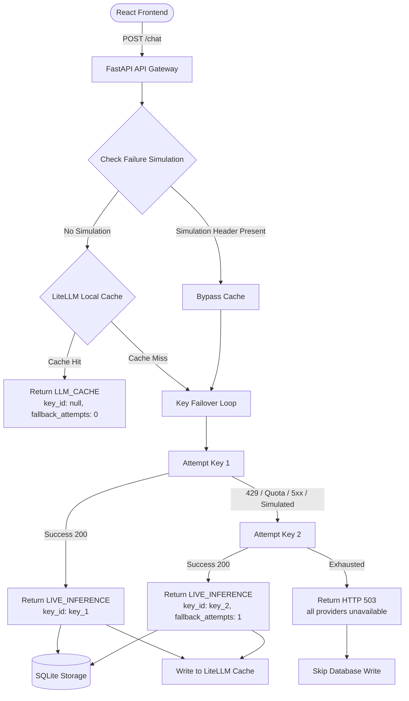

# LYFTR AI — Inference Control Center

Production-grade Full-Stack LLM Inference Gateway with automatic provider key failover, LiteLLM response caching, and persistent SQLite multi-turn session storage.

---

## 1. Live URLs

| Service | URL | Status | Description |
| :--- | :--- | :--- | :--- |
| **Frontend Application** | `https://lyftr-ai.vercel.app` *(Placeholder - Ready to Deploy)* | `Deployment Ready` | React 19 + Tailwind UI |
| **Backend API Gateway** | `https://lyftr-api.onrender.com` *(Placeholder - Ready to Deploy)* | `Deployment Ready` | FastAPI + LiteLLM Service |
| **Public GitHub Repository** | `https://github.com/your-username/lyftr-ai` *(Replace with repo URL)* | `Verified` | Full Monorepo |
| **Demo Video Walkthrough** | `https://youtu.be/placeholder-demo` *(2-3 min recording link)* | `Pending Recording` | Spoken demonstration |

> **Note on Deployment Readiness**: The entire stack is completely pre-configured for instant zero-code public deployment on **Vercel** (frontend) and **Render / Railway** (backend with persistent `/data` volume). See [docs/DEPLOYMENT.md](docs/DEPLOYMENT.md) for step-by-step instructions. Real API keys are not bundled in code or configuration and should be supplied in production environment variables.

---

## 2. Run locally: with Docker and without

### Prerequisites
- **Git**
- **Docker & Docker Compose** (for containerized setup)
- **Python 3.11+** & **Node.js 18+** (for non-containerized setup)

### Clone & Configure
```bash
git clone https://github.com/your-username/lyftr-ai.git
cd lyftr-ai
cp .env.example .env
```
Edit `.env` to supply at least two provider keys:
```env
LLM_API_KEYS=sk-proj-primary-key-1,sk-proj-secondary-key-2
LLM_MODEL=gemini/gemini-2.0-flash
ENABLE_FAILURE_SIMULATION=true
```

---

### Option A: Running with Docker (Recommended)

Start the full stack with a single command:
```bash
make up
```
Or directly with Docker Compose:
```bash
docker compose up -d --build
```

- **Frontend**: [http://localhost:3000](http://localhost:3000)
- **Backend API**: [http://localhost:8000](http://localhost:8000)
- **Health Check**: [http://localhost:8000/health](http://localhost:8000/health)

To view real-time logs:
```bash
make logs
```

To stop services (preserving SQLite database volume at `/data`):
```bash
make down
```

---

### Option B: Running without Docker

#### 1. Start Backend Service
```bash
cd backend
python3 -m venv venv
source venv/bin/activate
pip install -r requirements.txt

# Run migrations and start server on port 8000
export DATABASE_URL="sqlite:///./data/app.db"
export LLM_API_KEYS="mock_key_1,mock_key_2"
export LLM_MODEL="gemini/gemini-2.0-flash"
export ENABLE_FAILURE_SIMULATION=true
uvicorn app.main:app --host 0.0.0.0 --port 8000 --reload
```

#### 2. Start Frontend Application
In a separate terminal:
```bash
cd frontend
npm install
npm run dev
```
Open [http://localhost:3000](http://localhost:3000) in your browser.

---

### Running Automated Tests
Run both backend and frontend test suites (68 tests):
```bash
make test
```
Or individually:
```bash
make test-backend   # 55 pytest unit & integration tests
make test-frontend  # 13 vitest application flow tests
```

---

### Troubleshooting Common Issues
- **Port 8000 / 3000 in use**: Run `lsof -i :8000` or `lsof -i :3000` and kill conflicting processes.
- **SQLite permissions**: Ensure the `/data` directory exists and is writable by the app user.
- **CORS blocked**: Check that `ALLOWED_ORIGINS` in `.env` includes your frontend origin.

---

## 3. Design decisions: key fallback, caching, SQLite session storage



### 1. LiteLLM Key Failover Loop
- **Multi-Key Configuration**: Keys are configured via `LLM_API_KEYS=key1,key2,...` and identified deterministically as `key_1`, `key_2`, etc.
- **Failover Triggers**: Automatic fallback is executed on HTTP 429, provider quota exhaustion (`RateLimitError`, `resource_exhausted`), HTTP 500, 502, 503, and network timeouts.
- **Zero Exposure**: Raw API keys never touch the client, logs, or error responses.
- **Atomic Failure Handling**: If all configured keys fail, the API immediately returns HTTP 503 `{"detail": "all providers unavailable"}` without persisting half-saved records to SQLite.

### 2. Exact-Match LiteLLM Caching
- **Standard SDK Integration**: Uses LiteLLM's built-in local cache `Cache(type="local")` in process memory.
- **Context-Aware Logical Cache Key**: Incorporates model name, full system prompt, conversation history, and the new user message.
- **Session-Agnostic Matching**: The `session_id` is excluded from the cache key. An identical prompt asked in two completely separate sessions will hit the cache on the second request.
- **Cache Hit Contract**: On a cache hit, the gateway reports `resolution_source: "LLM_CACHE"`, sets `key_id: null`, sets `fallback_attempts: 0`, and preserves the original request's input and output token counts.

### 3. Persistent SQLite Session Storage
- **Minimal Schema Compliance**: Messages are stored in a dedicated SQLite table at `/data/app.db`:
  - `id`: INTEGER PRIMARY KEY AUTOINCREMENT
  - `session_id`: TEXT NOT NULL
  - `role`: TEXT NOT NULL
  - `content`: TEXT NOT NULL
  - `metadata`: TEXT (JSON serialized, assistant only)
  - `created_at`: TEXT NOT NULL (ISO-8601 UTC)
- **High Concurrency Configuration**: Configured with `PRAGMA journal_mode=WAL`, `PRAGMA synchronous=NORMAL`, and a 30-second busy timeout.
- **Session Prompt Persistence**: Effective system prompts are associated per session. Future turns reuse or update the session's prompt, but the system prompt is strictly excluded from `GET /sessions/{session_id}/messages`.

---

## 4. Verification: how to see failover, cache hits and per-message token usage

### 1. Health Endpoint
```bash
curl -s http://localhost:8000/health | jq
```
**Expected Response:**
```json
{
  "status": "ok",
  "keys_configured": 2,
  "cache_enabled": true
}
```

---

### 2. Live Inference (First Session)
```bash
curl -s -X POST http://localhost:8000/chat \
  -H "Content-Type: application/json" \
  -d '{"session_id": "s-demo-1", "message": "What is the speed of light?"}' | jq
```
**Expected Response:**
```json
{
  "session_id": "s-demo-1",
  "reply": "The speed of light in vacuum is approximately 299,792,458 meters per second.",
  "metadata": {
    "resolution_source": "LIVE_INFERENCE",
    "model": "gemini/gemini-2.0-flash",
    "latency_ms": 780,
    "input_tokens": 28,
    "output_tokens": 19,
    "key_id": "key_1",
    "fallback_attempts": 0
  }
}
```

---

### 3. Cache Hit (Second Independent Session)
Send the **identical query** in a **new session (`s-demo-2`)**:
```bash
curl -s -X POST http://localhost:8000/chat \
  -H "Content-Type: application/json" \
  -d '{"session_id": "s-demo-2", "message": "What is the speed of light?"}' | jq
```
**Expected Response:**
```json
{
  "session_id": "s-demo-2",
  "reply": "The speed of light in vacuum is approximately 299,792,458 meters per second.",
  "metadata": {
    "resolution_source": "LLM_CACHE",
    "model": "gemini/gemini-2.0-flash",
    "latency_ms": 2,
    "input_tokens": 28,
    "output_tokens": 19,
    "key_id": null,
    "fallback_attempts": 0
  }
}
```
*Notice: `resolution_source` is `LLM_CACHE`, `key_id` is `null`, latency dropped from ~780ms to ~2ms, and token counts are preserved.*

---

### 4. Automatic Key Failover (`key_1=429`)
Inject a simulated 429 rate limit onto the primary key:
```bash
curl -s -X POST http://localhost:8000/chat \
  -H "Content-Type: application/json" \
  -H "X-Simulate-Failure: key_1=429" \
  -d '{"session_id": "s-demo-3", "message": "Explain quantum entanglement briefly."}' | jq
```
**Expected Response:**
```json
{
  "session_id": "s-demo-3",
  "reply": "Quantum entanglement is a phenomenon where pairs of particles interact such that...",
  "metadata": {
    "resolution_source": "LIVE_INFERENCE",
    "model": "gemini/gemini-2.0-flash",
    "latency_ms": 845,
    "input_tokens": 32,
    "output_tokens": 22,
    "key_id": "key_2",
    "fallback_attempts": 1
  }
}
```
*Notice: Gateway automatically failed over to `key_2` with `fallback_attempts: 1` and returned a 200 response.*

---

### 5. Complete Failure (`*=429`)
Simulate all keys failing:
```bash
curl -s -X POST http://localhost:8000/chat \
  -H "Content-Type: application/json" \
  -H "X-Simulate-Failure: *=429" \
  -d '{"session_id": "s-demo-fail", "message": "Should not succeed."}' | jq
```
**Expected Response (HTTP 503):**
```json
{
  "detail": "all providers unavailable"
}
```

---

### 6. Verify SQLite Conversation History
```bash
curl -s http://localhost:8000/sessions/s-demo-1/messages | jq
```
**Expected Response:**
```json
{
  "session_id": "s-demo-1",
  "messages": [
    {
      "role": "user",
      "content": "What is the speed of light?"
    },
    {
      "role": "assistant",
      "content": "The speed of light in vacuum is approximately 299,792,458 meters per second.",
      "metadata": {
        "resolution_source": "LIVE_INFERENCE",
        "model": "gemini/gemini-2.0-flash",
        "latency_ms": 780,
        "input_tokens": 28,
        "output_tokens": 19,
        "key_id": "key_1",
        "fallback_attempts": 0
      }
    }
  ]
}
```

---

## 5. Setup Used: your editor and AI tools

- **Editor / Development Environment**: VS Code / Antigravity IDE on macOS.
- **AI Coding Assistant**: Google DeepMind Antigravity Agent (Gemini 3.8 Flash & Claude Opus 4.6).
- **Backend Stack**: Python 3.11/3.13, FastAPI 0.115, LiteLLM SDK 1.55, SQLAlchemy 2.0, SQLite3, Pytest, HTTPX.
- **Frontend Stack**: React 19, TypeScript 5.7, Vite 6, Tailwind CSS 3.4, Lucide Icons, Vitest, React Testing Library.

---

## 6. Bonus features (if any): what you added beyond the requirements and why

1. **Resilience Lab Panel**:
   - An interactive UI panel with 1-click failure presets (`key_1=429`, `key_1=500`, `*=429`, `key_1=429,key_2=500`) and custom failure string input.
   - Passes the real `X-Simulate-Failure` header to test and visually confirm gateway failover without needing external cURL scripts.
2. **Real-Time Technical Inference Inspector**:
   - Collapsible desktop inspector displaying live health telemetry, key pool count, active cache status, model name, and individual token counts.
3. **SQLite History Verification Drawer**:
   - A 1-click verification tool in the UI that queries `GET /sessions/{session_id}/messages` and shows the raw persisted SQLite messages to prove backend persistence.
4. **Session System Prompt Editor**:
   - Interactive modal with testid `system-prompt-input` allowing users to configure or reset custom system instructions per session.
5. **One-Click Markdown Code Copy**:
   - Copy response buttons with animated feedback for all assistant replies.
6. **Smart Empty State with Architecture Guidance**:
   - Pre-populated clickable prompt cards demonstrating key failover, caching, and multi-turn state.
