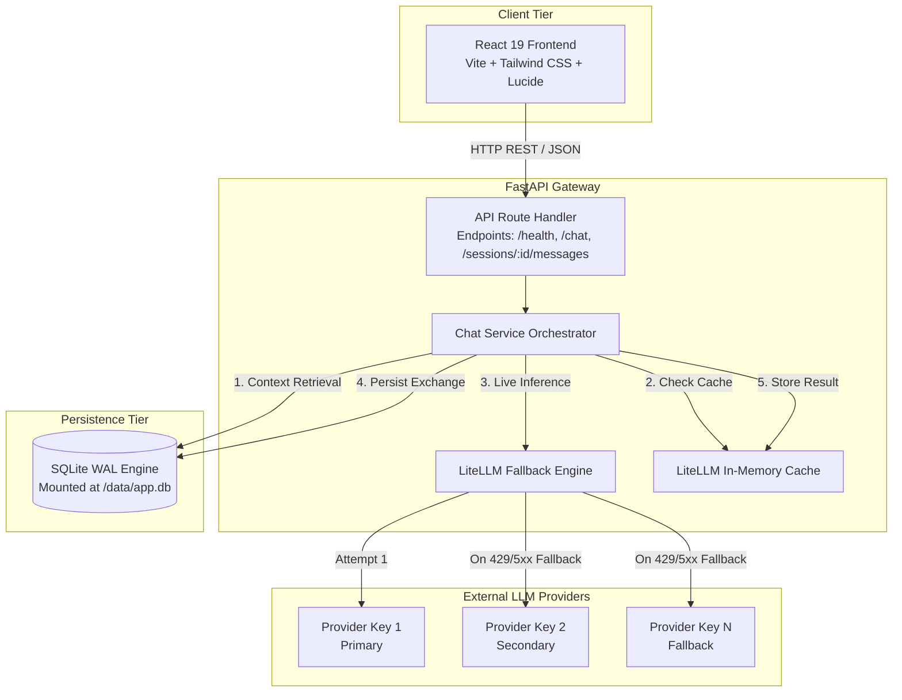
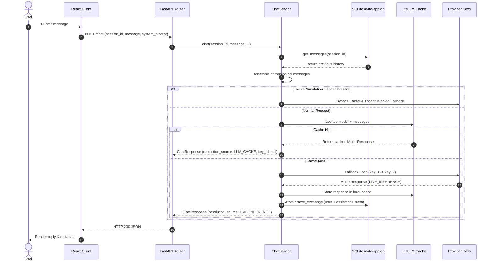
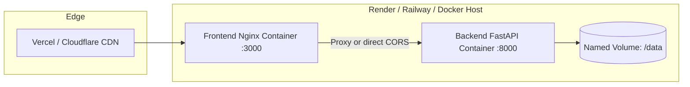

# LYFTR AI — System Architecture

Comprehensive architectural specification for the LYFTR AI Inference Control Center.

---

## 1. High-Level Architecture Overview



---

## 2. Component Breakdown

### A. Frontend Tier (React 19 + TypeScript)
- **Three-Zone Workspace**:
  - **Sidebar**: Session management, SQLite WAL status, system prompt config, Resilience Lab trigger.
  - **Conversation Feed**: User & assistant messages, markdown formatting, per-message metadata visualization with strict `data-testid` compliance.
  - **Inference Inspector**: Real-time telemetry inspector, model identifier, latency metrics, and SQLite history verification.
- **State Management & Session Navigation**:
  - Remembers active and recent session identifiers in browser `localStorage`.
  - On page load / refresh, automatically restores conversation state via `GET /sessions/{session_id}/messages` from SQLite.
  - Sidebar session list enables switching between active/past sessions and starting clean sessions.
  - Full conversation history and message persistence reside strictly in backend SQLite.

### B. Backend Tier (FastAPI + LiteLLM SDK)
- **`app.config.Settings`**: Immutable configuration loader parsing environment variables (`LLM_API_KEYS`, `LLM_MODEL`, `DATABASE_URL`, `ENABLE_FAILURE_SIMULATION`).
- **`app.database.Database`**: Thread-safe SQLite database manager utilizing WAL journal mode, busy timeouts, and atomic multi-row transactions.
- **`app.llm.client.LLMClient`**: Core LiteLLM gateway wrapper responsible for:
  1. Exact-match request caching using LiteLLM local memory cache.
  2. Sequential key fallback loop with retryable error classification (retrying 429, quota exhaustion, 5xx, timeouts, connection failures; immediately failing fast on non-retryable 4xx).
  3. Reliable token usage tracking with LiteLLM estimation heuristics for missing/partial provider usage.
  4. Request-scoped failure simulation via `X-Simulate-Failure`.
- **`app.services.chat_service.ChatService`**: Business logic layer managing session context retrieval, system prompt resolution, and message persistence.
- **`app.api.routes`**: Strict API contract exposing only the 3 permitted application endpoints (`GET /health`, `POST /chat`, `GET /sessions/{session_id}/messages`). Offloads synchronous database and LiteLLM operations to worker threadpool via `run_in_threadpool` to prevent blocking the async event loop. Automatically disables Swagger/OpenAPI routes (`/docs`, `/redoc`, `/openapi.json`).

---

## 3. Data Flow & Request Lifecycles

### Chat Inference Sequence



---

## 4. Database Schema Design

The SQLite database lives under `/data/app.db` (persisted by Docker volume `sqlite_data`):

### `messages` Table
```sql
CREATE TABLE messages (
    id INTEGER PRIMARY KEY AUTOINCREMENT,
    session_id TEXT NOT NULL,
    role TEXT NOT NULL,            -- 'user' or 'assistant'
    content TEXT NOT NULL,
    metadata TEXT,                 -- JSON serialized metadata (assistant messages only)
    created_at TEXT NOT NULL       -- ISO-8601 UTC timestamp
);

CREATE INDEX ix_messages_session_id ON messages (session_id);
CREATE INDEX ix_messages_created_at ON messages (created_at);
```

### `sessions` Table
```sql
CREATE TABLE sessions (
    id INTEGER PRIMARY KEY AUTOINCREMENT,
    session_id TEXT NOT NULL UNIQUE,
    system_prompt TEXT,            -- Session-persisted effective system prompt
    created_at TEXT NOT NULL,
    updated_at TEXT NOT NULL
);

CREATE UNIQUE INDEX ix_sessions_session_id ON sessions (session_id);
```

---

## 5. Deployment Architecture


